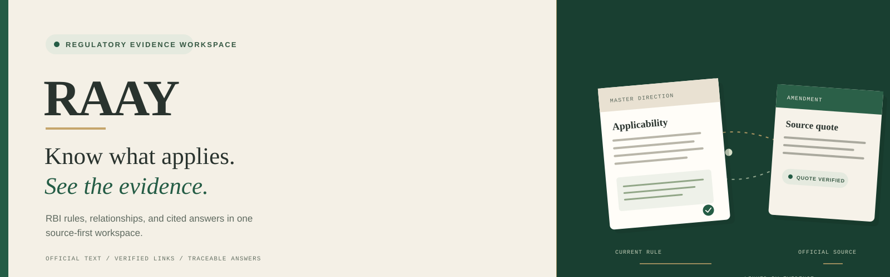
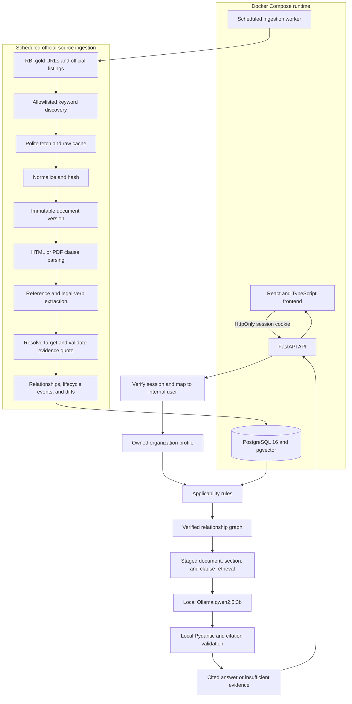

<h1 align="center">RAAY By Team WhoCares</h1>

<p align="center">
  
</p>

<p align="center"><strong>Regulatory relationship engine for RBI documents</strong></p>
<p align="center">Applicability, verified document history, and cited answers grounded in official text.</p>

<p align="center">
  <a href="#problem">Product</a> ·
  <a href="#complete-planned-flow">Architecture</a> ·
  <a href="#getting-started">Run locally</a> ·
  <a href="#configuration">Configuration</a> ·
  <a href="#limitations-and-disclaimer">Limits</a>
</p>
---

## Problem

The Reserve Bank of India issues a large volume of circulars, directions, amendments and drafts, and keeps rewriting them. A compliance officer at a small NBFC or microfinance company cannot easily tell:

1. which documents apply to their business,
2. what changed, and whether the old rule is still in force,
3. which drafts are open for comment right now.

Generic AI chatbots do not solve this. They can sound confident while citing a repealed rule or a document that does not apply to the user.

## Solution

RAAY collects RBI documents into a shared knowledge base and computes how they relate. It then shows each user only what applies to them and attaches the official text as proof. When something cannot be proven, it says **"not established"**.

Core ideas:

- **Evidence over similarity.** A relationship such as *amends* or *replaces* is created only from explicit official text. Language models may suggest candidates; deterministic code verifies them, and every quote must exist verbatim in the source.
- **Three separate relevance questions:** document to document, document to stakeholder, and clause to stakeholder.
- **Lifecycle awareness.** In November 2025 RBI consolidated its instructions into new Master Directions, so RAAY tracks whether a rule is in force, amended, repealed or consolidated.
- **Staged retrieval instead of flat RAG:** eligible documents, then verified relationships, then sections, then clauses.

## What users can do

- Describe their business once (entity type, NBFC category, activities).
- See a "Relevant to you" feed with open consultations and recent circulars.
- Open a document to see why it applies (official quote), which clauses matter, what it amends, and old vs new text.
- Ask questions scoped to selected documents and get cited answers, or "insufficient evidence".
- *(Planned)* Draft verified feedback on a draft rule; receive alerts.

## Complete planned flow

This diagram is the end-to-end target for the MVP. It includes later phases that are not implemented yet. For the smaller, phase-by-phase record of code that exists today, see [`flow.md`](flow.md).



One shared regulatory knowledge base serves all users. Authenticated profiles are isolated by the internal user derived from a revocable server-side session. Passwords use Argon2id hashes; browser sessions use HttpOnly cookies. Local Ollama receives only deterministically retrieved evidence and cannot create verified relationships or bypass citation validation. Design reasons are recorded in [`decision.md`](decision.md).

## Tech stack

| Area | Choice |
|------|--------|
| Backend | Python 3.12, FastAPI, pydantic |
| Database | PostgreSQL 16, `pgvector`, built-in full-text search |
| Ingestion | httpx, selectolax, PyMuPDF (fallback), APScheduler 3, Tesseract (optional OCR) |
| Matching | rapidfuzz, rule engine, entity ontology |
| Embeddings | BGE-M3 (default, local, 1024-d); alternatives evaluated in `decision.md` |
| Answer LLM | Local Ollama `qwen2.5:3b` with structured JSON output |
| Frontend | React, TypeScript, Vite, native email/password form |

## Repository layout

```
backend/app/{ingest,parse,refs,relations,lifecycle,applicability,retrieval,answer,api}/
backend/tests/   db/   data/gold/   data/raw/   frontend/
plan.md  decision.md  flow.md  codex.md  README.md  contracts/
```

## Getting started

**Prerequisites:** Docker with Compose and Git. Node.js is not needed for the Compose frontend. Python 3.12 is needed only for local CLI commands. Tesseract remains optional for future OCR fallback.

### First Docker run

```bash
cp .env.example .env
ollama pull qwen2.5:3b
docker compose up -d --build
docker compose ps
docker compose logs -f worker
```

Ollama can keep its default loopback listener on `127.0.0.1:11434`; Docker Desktop exposes the host service to the API container as `host.docker.internal`. Compose does not publish port `11434`. Set `OLLAMA_BASE_URL=http://host.docker.internal:11434` and `OLLAMA_ANSWER_MODEL=qwen2.5:3b` in `.env`.

On first run, Docker downloads the PostgreSQL/pgvector base image and builds the API, worker, and frontend images with their dependencies. The worker then fetches and ingests the nine URLs listed in `data/gold/corpus.yaml`. The API downloads BGE-M3 weights at startup into `data/huggingface/` if that cache is empty. RBI source files live in `data/raw/`; PostgreSQL records live in the `postgres_data` Docker volume. These caches persist across ordinary container recreation. Removing the database volume deletes database records; removing `data/` deletes downloaded RBI files and embedding weights. Rebuilds reuse Docker layers and cached model files when dependencies and cache directories remain.

The worker does not automatically run relationship, applicability, lifecycle, or embedding reconciliation after gold ingestion. Run those jobs once for a fresh database, then rerun embeddings after adding documents:

```bash
docker compose exec worker python -m app.relations.run
docker compose exec worker python -m app.applicability.run
docker compose exec worker python -m app.lifecycle.run
docker compose exec worker python -m app.embeddings.run
```

`docker compose up` does not download every RBI document. It loads only the curated gold list, then polls four RBI listing pages on a schedule and stores only title matches for the configured keywords. This is not a user-specific global regulatory search index.

```bash
# 1. Get the code
git clone <repository-url> raay
cd raay

# 2. Configure local values
cp .env.example .env

# 3. Start PostgreSQL 16 with pgvector on host port 5433
docker compose up -d db

# 4. Backend
python -m venv .venv && source .venv/bin/activate
pip install -e 'backend[dev]'

# 5. Load the curated official RBI gold corpus (also done by the Compose worker)
python -m app.ingest.run --source gold

# Reconcile references and verified relationships after ingestion
python -m app.relations.run

# Reconcile applicability facts and recompute lifecycle states
python -m app.applicability.run
python -m app.lifecycle.run

# Embed current clauses locally for semantic retrieval
python -m app.embeddings.run

# Discover matching documents from one official RBI listing
python -m app.ingest.run --source drafts
python -m app.ingest.run --source notifications --keywords 'microfinance,nbfc,know your customer'

# Existing database: apply user/profile and native-auth migrations before app start
docker compose exec -T db psql -v ON_ERROR_STOP=1 -U postgres -d raay \
  -f /migrations/005_authenticated_profiles.sql
docker compose exec -T db psql -v ON_ERROR_STOP=1 -U postgres -d raay \
  -f /migrations/006_native_email_auth.sql

# 6. Start app containers (frontend at http://localhost:5173)
docker compose up -d --build api worker frontend

# 7. Run the API locally instead, if preferred
uvicorn app.api.main:app --reload

# 8. Tests and static checks
cd backend
../.venv/bin/pytest -q
../.venv/bin/ruff check app tests
../.venv/bin/mypy app
```

All CLI sources are implemented: `gold`, `drafts`, `notifications`, `masterdirs`, and `withdrawn`. Live sources filter document titles using `RBI_DISCOVERY_KEYWORDS`, accept only known official RBI detail endpoints, and stop after the configured per-source match cap. `--keywords` provides a one-run override.

The worker first idempotently loads the gold corpus, then schedules drafts and notifications every three hours on weekdays and Master Directions and withdrawn circulars daily. The curated corpus contains:

- Microfinance Loans Directions (2022), NBFC-MFI Directions (2025), qualifying-assets review (2025), and the 2025 circular-withdrawal notice.
- KYC Directions (2016) and its 2024 amendment.
- NBFC IT Governance (2023), NBFC Fraud Risk Management (2024), and Internal Ombudsman (2023) Directions.

This is a small evidence-tested starting corpus, not complete RBI coverage. Set `RBI_SCHEDULER_RUN_ON_STARTUP=true` only when an immediate poll of all four live listings is wanted; scheduled polling still runs when it is false.

The API exposes public `GET /health`; all document, relationship, profile, relevant-feed, and question routes require a valid native session cookie. Passwords are Argon2id-hashed; sessions are random, revocable, and stored by digest. Email verification and password reset are not implemented; keep this prototype private. Gold ingestion is idempotent: an unchanged rerun creates zero document versions, repairs missing raw-cache metadata, and records the run in `ingest_runs`. Relationship and applicability reconciliation are also idempotent. The withdrawn-source run caches the official table; relationship reconciliation parses exact table rows into verified repeal evidence. Lifecycle recomputation uses only verified relationships. Question answering uses verified relationship expansion, PostgreSQL full-text and local BGE-M3 dense retrieval, local Ollama structured claims, and exact quote checks. Stage timing logs expose retrieval, embedding, LLM, verification, and total durations without question text or quotes. Run `python -m app.embeddings.run` after ingesting new documents; the job skips clauses already embedded with the selected model.

For an existing Compose database, apply additive schema changes before reconciliation:

```bash
docker compose up -d db
docker compose exec -T db psql -v ON_ERROR_STOP=1 -U postgres -d raay \
  -f /docker-entrypoint-initdb.d/001-schema.sql
docker compose exec -T db psql -v ON_ERROR_STOP=1 -U postgres -d raay \
  -f /docker-entrypoint-initdb.d/002-seed-ontology.sql
docker compose exec -T db psql -v ON_ERROR_STOP=1 -U postgres -d raay \
  -f /migrations/004_clause_embeddings.sql
docker compose exec -T db psql -v ON_ERROR_STOP=1 -U postgres -d raay \
  -f /migrations/005_authenticated_profiles.sql
docker compose exec -T db psql -v ON_ERROR_STOP=1 -U postgres -d raay \
  -f /migrations/006_native_email_auth.sql
docker compose exec -T worker python -m app.relations.run
docker compose exec -T worker python -m app.applicability.run
docker compose exec -T worker python -m app.lifecycle.run
```

## Configuration

| Variable | Purpose |
|----------|---------|
| `DATABASE_URL` | PostgreSQL connection string |
| `POSTGRES_PORT` | Host port for the Compose database (default `5433`) |
| `RAW_CACHE_DIR` | Directory for cached official responses |
| `RBI_USER_AGENT` | Descriptive user agent used for RBI requests |
| `RBI_REQUEST_INTERVAL_SECONDS` | Minimum request spacing; cannot be below one second |
| `RBI_DISCOVERY_KEYWORDS` | Comma-separated, case-insensitive document-title keywords for live discovery |
| `RBI_DISCOVERY_MAX_MATCHES_PER_SOURCE` | Maximum matching detail documents fetched from one listing per run (default `20`) |
| `RBI_SCHEDULER_TIMEZONE` | Timezone used by periodic polling (default `Asia/Kolkata`) |
| `RBI_SCHEDULER_RUN_ON_STARTUP` | Whether the worker immediately polls all live listings after gold bootstrap |
| `EMBEDDING_MODEL` | Embedding model name (default `BAAI/bge-m3`) |
| `EMBEDDING_DEVICE` | Local model device (default `cpu`; set to a supported CUDA device when available) |
| `EMBEDDING_CPU_THREADS` | Torch CPU thread cap for BGE-M3 (default `4`) |
| `EMBEDDING_BATCH_SIZE` | Number of clauses encoded per batch (default `32`) |
| `OLLAMA_BASE_URL` | Ollama server URL reachable from the API container (default `http://host.docker.internal:11434`) |
| `OLLAMA_ANSWER_MODEL` | Local answer model (default `qwen2.5:3b`) |
| `OLLAMA_TIMEOUT_SECONDS` | Ollama request timeout in seconds (default `120`) |
| `SESSION_COOKIE_SECURE` | Set `true` when serving over HTTPS; keep `false` for localhost |
| `SESSION_TTL_HOURS` | Server-side session lifetime (default `168` hours) |
| `FRONTEND_ORIGIN` | Allowed browser origin for cookie-authenticated requests |

Never commit real keys. All variables will be listed in `.env.example`.

## Project documents

| File | Purpose |
|------|---------|
| [`plan.md`](plan.md) | 12-hour plan, phases, deliverables, acceptance checks |
| [`decision.md`](decision.md) | Design decisions and the reasons for them |
| [`flow.md`](flow.md) | Phase-by-phase record of the implementation that exists today |
| [`codex.md`](codex.md) | Instructions for the Codex coding agent (copy to `AGENTS.md`) |

## Current status

Phases 1–3 are implemented. Phase 4 returns a grounded 60% answer with verified quote and RBI DOM locator; BGE-M3 vectors have been indexed locally. Phase 5 includes native email/password auth, isolated profiles, relevance matching, and focused overview, regulations, profile, explorer, and question screens. Live account flows and cross-user acceptance remain. Email verification and password reset are not implemented; keep this prototype private. The Phase 2 official historical old-text diff remains deferred. See [`flow.md`](flow.md) for implementation history.

## Limitations and disclaimer

- Coverage is intentionally narrow: a small set of verified RBI documents, not the full RBI site.
- Evaluation uses a small hand-labelled set; results are reported as counts, not general accuracy.
- Source documents are public RBI publications. Always check the official RBI website for the current text.
- RAAY is a research and decision-support tool, **not legal or compliance advice**.
