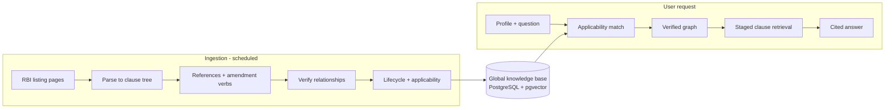

# RAAY — Regulatory Relationship Engine for RBI Documents

An evidence-backed system that shows regulated entities which RBI documents apply to them, how those documents connect to existing rules, and what has changed, with the official sentence attached to every claim.

> **Status:** Phase 1 in progress. Gold ingestion, capped keyword discovery from four official RBI listings, periodic polling, immutable versions, HTML/PDF parsing, PostgreSQL storage, and the read API are implemented.

---

## Problem

The Reserve Bank of India issues a large volume of circulars, directions, amendments and drafts, and keeps rewriting them. A compliance officer at a small NBFC or microfinance company cannot easily tell:

1. which documents apply to their business,
2. what changed, and whether the old rule is still in force,
3. which drafts are open for comment right now.

Generic AI chatbots do not solve this. They can sound confident while citing a repealed rule or a document that does not apply to the user.

## Solution

RAAY collects RBI documents into a shared knowledge base and computes how they relate. It then shows each user only what applies to them and attaches the official text as proof. When something cannot be proven, it says **"not established"**.

Core ideas:

- **Evidence over similarity.** A relationship such as *amends* or *replaces* is created only from explicit official text. Language models may suggest candidates; deterministic code verifies them, and every quote must exist verbatim in the source.
- **Three separate relevance questions:** document to document, document to stakeholder, and clause to stakeholder.
- **Lifecycle awareness.** In November 2025 RBI consolidated its instructions into new Master Directions, so RAAY tracks whether a rule is in force, amended, repealed or consolidated.
- **Staged retrieval instead of flat RAG:** eligible documents, then verified relationships, then sections, then clauses.

## What users can do

- Describe their business once (entity type, NBFC category, activities).
- See a "Relevant to you" feed with open consultations and recent circulars.
- Open a document to see why it applies (official quote), which clauses matter, what it amends, and old vs new text.
- Ask questions scoped to selected documents and get cited answers, or "insufficient evidence".
- *(Planned)* Draft verified feedback on a draft rule; receive alerts.

## Architecture



One shared knowledge base serves all users; per-user data is limited to the profile, cached results and drafts. Detailed diagrams and build status: [`flow.md`](flow.md). Design reasons: [`decision.md`](decision.md).

## Tech stack

| Area | Choice |
|------|--------|
| Backend | Python 3.12, FastAPI, pydantic |
| Database | PostgreSQL 16, `pgvector`, built-in full-text search |
| Ingestion | httpx, selectolax, PyMuPDF (fallback), APScheduler 3, Tesseract (optional OCR) |
| Matching | rapidfuzz, rule engine, entity ontology |
| Embeddings | BGE-M3 (default, local, 1024-d); alternatives evaluated in `decision.md` |
| LLM | Gemini 3.8 Flash behind a provider-neutral interface; planned for Phase 4 |
| Frontend | React with Vite, TypeScript |

## Repository layout

```
backend/app/{ingest,parse,refs,relations,lifecycle,applicability,retrieval,answer,api}/
backend/tests/   db/   data/gold/   data/raw/   frontend/
plan.md  decision.md  flow.md  codex.md  README.md  contracts/
```

## Getting started

**Prerequisites:** Python 3.12, Docker with Compose, Git. Node.js 20+ is required when frontend work begins. Tesseract remains optional for future OCR fallback.

```bash
# 1. Get the code
git clone <repository-url> raay
cd raay

# 2. Configure local values
cp .env.example .env

# 3. Start PostgreSQL 16 with pgvector on host port 5433
docker compose up -d db

# 4. Backend
python -m venv .venv && source .venv/bin/activate
pip install -e 'backend[dev]'

# 5. Load the six-document official RBI gold corpus
python -m app.ingest.run --source gold

# Discover matching documents from one official RBI listing
python -m app.ingest.run --source drafts
python -m app.ingest.run --source notifications --keywords 'microfinance,nbfc,know your customer'

# 6. Run the API locally
uvicorn app.api.main:app --reload

# Or build and run the current containers
docker compose build api worker
docker compose up -d api worker

# 7. Tests and static checks
cd backend
../.venv/bin/pytest -q
../.venv/bin/ruff check app tests
../.venv/bin/mypy app
```

All CLI sources are implemented: `gold`, `drafts`, `notifications`, `masterdirs`, and `withdrawn`. Live sources filter document titles using `RBI_DISCOVERY_KEYWORDS`, accept only known official RBI detail endpoints, and stop after the configured per-source match cap. `--keywords` provides a one-run override.

The worker first idempotently loads the gold corpus, then schedules drafts and notifications every three hours on weekdays and Master Directions and withdrawn circulars daily. Set `RBI_SCHEDULER_RUN_ON_STARTUP=true` only when an immediate poll of all four live listings is wanted; scheduled polling still runs when it is false.

The API currently exposes `GET /health`, `GET /documents`, and `GET /documents/{id}/clauses`. Gold ingestion is idempotent: an unchanged immediate rerun creates zero document versions and records the run in `ingest_runs`.

## Configuration

| Variable | Purpose |
|----------|---------|
| `DATABASE_URL` | PostgreSQL connection string |
| `POSTGRES_PORT` | Host port for the Compose database (default `5433`) |
| `RAW_CACHE_DIR` | Directory for cached official responses |
| `RBI_USER_AGENT` | Descriptive user agent used for RBI requests |
| `RBI_REQUEST_INTERVAL_SECONDS` | Minimum request spacing; cannot be below one second |
| `RBI_DISCOVERY_KEYWORDS` | Comma-separated, case-insensitive document-title keywords for live discovery |
| `RBI_DISCOVERY_MAX_MATCHES_PER_SOURCE` | Maximum matching detail documents fetched from one listing per run (default `20`) |
| `RBI_SCHEDULER_TIMEZONE` | Timezone used by periodic polling (default `Asia/Kolkata`) |
| `RBI_SCHEDULER_RUN_ON_STARTUP` | Whether the worker immediately polls all live listings after gold bootstrap |
| `EMBEDDING_MODEL` | Embedding model name (default `BAAI/bge-m3`) |
| `GEMINI_EXTRACT_MODEL`, `GEMINI_ANSWER_MODEL` | Gemini model identifiers for later extraction and answers |
| `GEMINI_API_KEY` | Gemini API key; not used by Phase 1 ingestion |
| `AUTH0_DOMAIN`, `AUTH0_AUDIENCE`, `AUTH0_CLIENT_ID` | Auth0 values for the planned authenticated UI/API |

Never commit real keys. All variables will be listed in `.env.example`.

## Project documents

| File | Purpose |
|------|---------|
| [`plan.md`](plan.md) | 12-hour plan, phases, deliverables, acceptance checks |
| [`decision.md`](decision.md) | Design decisions and the reasons for them |
| [`flow.md`](flow.md) | Current architecture flowcharts and build status |
| [`codex.md`](codex.md) | Instructions for the Codex coding agent (copy to `AGENTS.md`) |

## Current status

Phase 1 is in progress. Six official RBI documents are source-locked; the ingestion/versioning/parser core, read API, live keyword discovery, audited CLI runs, and scheduled Compose worker pass their checks. A live KYC draft was ingested and its immediate rerun created zero versions. The Phase 0 labelled-pair fixture remains pending. See [`flow.md`](flow.md) for component status.

## Limitations and disclaimer

- Coverage is intentionally narrow: a small set of verified RBI documents, not the full RBI site.
- Evaluation uses a small hand-labelled set; results are reported as counts, not general accuracy.
- Source documents are public RBI publications. Always check the official RBI website for the current text.
- RAAY is a research and decision-support tool, **not legal or compliance advice**.
