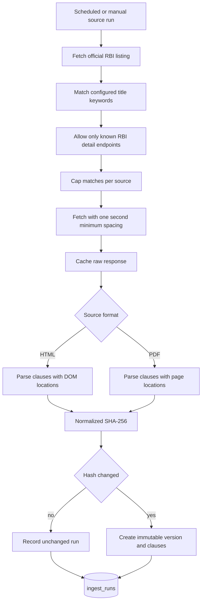
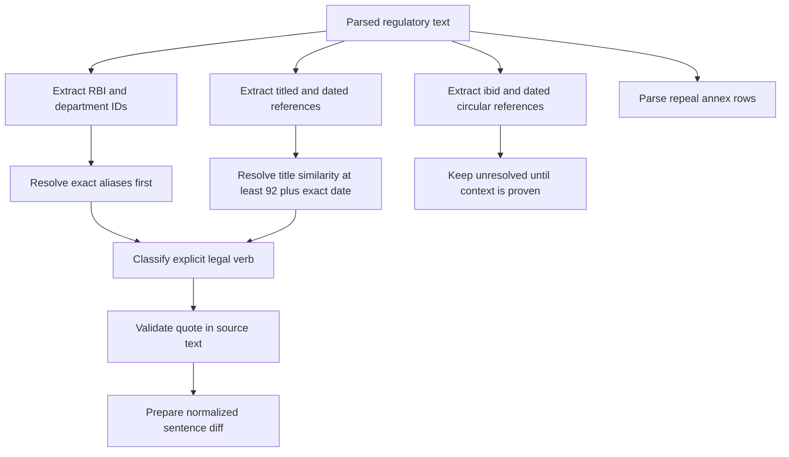
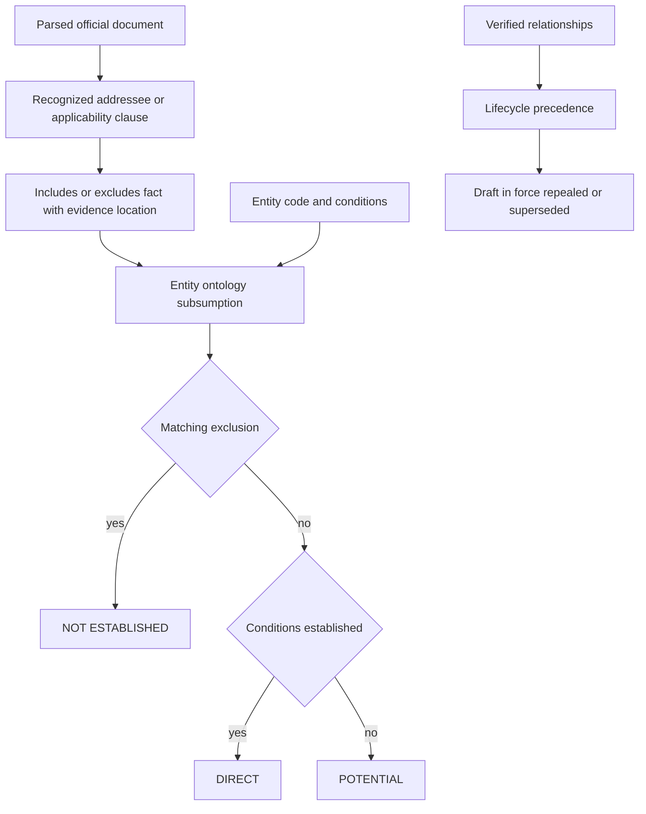
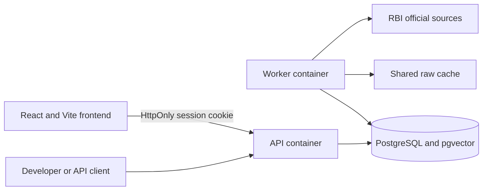

# flow.md — What RAAY Has Built So Far

This document shows only behavior implemented in code so far. The complete target architecture remains in [`README.md`](README.md) and [`plan.md`](plan.md). New implemented behavior is added phase by phase so the build history stays easy to follow.

**Last updated:** 2026-11-01  
**Current phase:** Phase 5 in progress — native auth, profiles, separated pages, quick navigation, and evidence-scoped overview counts added; live account-flow acceptance pending

Status legend: `Done` means implemented and checked · `In progress` means code exists but the phase acceptance path is incomplete

---

## 1. Current implementation

```mermaid
flowchart LR
  FE[React email/password frontend] -->|HttpOnly session cookie| API[FastAPI API]
  API --> TOK[Verify session and derive internal user]
  TOK --> AUTHDB[(Users and hashed session tokens)]

  RBI[RBI official listings] --> SCH[APScheduler worker]
  SCH --> DIS[Allowlisted title keyword discovery]
  DIS --> FET[Polite fetch and raw cache]
  GOLD[Locked gold URLs] --> FET
  FET --> PAR[HTML or PDF parser]
  PAR --> VER[Immutable document versions and clauses]
  VER --> DB[(PostgreSQL and pgvector)]
  DB --> API

  VER --> REF[Reference extraction]
  REF --> CLS[Explicit verb classification]
  CLS --> RSV[Alias or title and date resolution]
  RSV --> QV[Quote span validation]
  QV --> DIF[Sentence diff and repeal row parsing]
  QV --> RDB[Idempotent relationship persistence]
  RDB --> DB
  WLIST[Official withdrawn-circular table] --> WPARSE[Parse reference, title, date, and DOM evidence]
  WPARSE --> WRES[Resolve exact corpus aliases]
  WRES --> RDB
  DB --> RAPI[FastAPI relationship evidence endpoint]
  VER --> AF[Deterministic addressee extraction]
  AF --> ADB[Applicability facts]
  ADB --> DB
  DB --> LC[Lifecycle computation from verified edges]
  Q[Question and selected document IDs] --> SR[Scoped FTS retrieval]
  RDB --> SR
  SR --> RRF[Rank clauses with reciprocal-rank fusion seam]
  RRF --> OLLAMA[Local Ollama qwen2.5:3b with JSON Schema]
  OLLAMA --> CV[Validate Pydantic claims and exact source quotes]
  CV --> ANS[Cited claims or insufficient evidence]
  ANS --> API
```

The ingestion, relationship, applicability, and lifecycle paths run end to end. Old-versus-new diff persistence remains empty until both texts come from reproducible official RBI artifacts.

---

## 2. Phase 0 additions — foundation and source lock

### Implemented

- Docker Compose database, API, and worker services.
- PostgreSQL 16 with pgvector.
- Nine source-locked official RBI gold documents in `data/gold/corpus.yaml`.
- Environment contracts for RBI polling, native sessions, Ollama, and embeddings.
- Initial database schema and repository layout.

---

## 3. Phase 1 additions — discovery, ingestion, versioning, and parsing

### Implemented and checked

- Fixed gold-corpus ingestion.
- Live discovery from RBI drafts, notifications, Master Directions, and withdrawn-circular listings.
- Title keyword configuration, official endpoint allowlist, stable URL keys, and per-source match cap.
- Drafts and notifications every three hours on weekdays; Master Directions and withdrawn circulars daily.
- Robots policy checks, descriptive user agent, minimum one-second request spacing, and raw caching.
- HTML-first parsing with PDF fallback.
- Normalized offsets plus HTML DOM or PDF page evidence locations.
- Immutable document versions and idempotent reruns.
- `GET /health`, `GET /documents`, and `GET /documents/{id}/clauses`.
- Every run audited in `ingest_runs`.
- Gold manifest expanded from six to nine: added RBI NBFC IT Governance (2023), NBFC Fraud Risk Management (2024), and Internal Ombudsman (2023) Directions.
- Local database now has all nine documents and 1,057 clauses. The three additions contributed 334 clauses.
- Relationship reconciliation ran across nine sources (268 rows); applicability reconciliation stored 12 facts; lifecycle now marks 5 documents repealed and 4 in force.

---

## 4. Phase 2 additions — relationship engine so far

### Implemented and unit-tested

- RBI and departmental reference extraction with source spans.
- Titled Master Direction, publication-date, target-clause, `ibid`, and dated-circular extraction.
- Table-driven classification for amended, substituted, inserted, deleted, omitted, replaced, repealed, withdrawn, superseded, and consolidated relationships.
- Negative rules preventing phrases such as “as amended from time to time” from creating edges.
- Resolution order: exact alias, then title similarity of at least 92 with an exact publication date, otherwise unresolved.
- Unicode and whitespace-normalized quote-span validation.
- Sentence-level old/new diff preparation.
- Deterministic repeal-annex row parsing.
- Adjacent evidence paragraphs are combined when a reference and its legal instruction span separate HTML or PDF blocks.
- Additive `document_relations` and `clause_versions` schema with an explicit rollback script.
- Pull-based `python -m app.relations.run` reconciliation with audited runs and idempotent upserts.
- Missing raw files are reported and skipped without blocking valid source documents.
- Unchanged ingestion backfills missing raw-cache metadata without creating another document version.
- `GET /documents/{id}/relations` returns incoming and outgoing evidence, verification status, source location, and available diff fields.
- Live verification persisted 251 unique rows across the current local corpus: one explicit `VERIFIED AMENDS` edge and 250 `CANDIDATE RELATED_TO` references. A second run kept the row count at 251.

### Current Phase 2 boundary

The official RBI historical artifact containing the earlier paragraph 8.1 is still unavailable locally. Therefore `old_text`, `new_text`, and the persisted diff for RBI/2025-26/44 remain incomplete, and Phase 2 acceptance has not passed.

---

## 5. Phase 3 additions — lifecycle and applicability so far

### Implemented and checked

- Entity ontology for banks, co-operative banks, NBFCs, NBFC-ICC, NBFC-MFI, HFC, and bank subtypes.
- Subsumption matching, such as `NBFC_MFI` satisfying an `NBFC` inclusion.
- Exclusions override inclusions; unmet or absent conditions never produce `DIRECT`.
- Sixteen table-driven profile×fact cases plus lifecycle precedence tests.
- Deterministic addressee extraction with HTML DOM or PDF page evidence locations.
- Additive `entity_ontology` and `applicability_facts` schema with explicit rollback.
- Audited `python -m app.applicability.run` reconciliation with idempotent upserts.
- Live run stored 12 official facts; the second run kept the row count at 12.
- RBI/2025-26/44 stored `NBFC_MFI INCLUDES` with the official addressee and DOM locator.
- Audited `python -m app.lifecycle.run` computes state only from dates and verified relationships.
- Official withdrawn-circular table parsing stores exact reference, title, date, DOM location, offsets, and source URL.
- Exact corpus aliases from the table create idempotent `VERIFIED REPEALS` edges; unknown rows remain outside the narrow corpus.
- Live lifecycle reconciliation marks 4 documents `REPEALED` and 7 `IN_FORCE`.
- RBI/2025-26/44 is `REPEALED` from official withdrawal evidence.

### Phase 3 acceptance

An NBFC-MFI matches RBI/2025-26/44 as `DIRECT`, while NBFC-ICC is `NOT_ESTABLISHED`. The document is `HISTORICAL — repealed` because the official withdrawal table proves repeal. It is not labelled consolidated because no official evidence names a consolidation target.

---

## 6. Phase 4 additions — scoped retrieval and grounded answers so far

### Implemented

- `POST /questions` accepts a question and explicit document IDs.
- Retrieval expands scope up to one hop using verified relationships only, then searches current-version clauses with PostgreSQL full-text search.
- Reciprocal-rank fusion combines lexical and semantic rankings when current scoped vectors exist.
- Local Ollama adapter sends the Pydantic JSON Schema to `/api/chat` and validates returned JSON locally.
- Claim validation requires a retrieved clause ID and a quote found in that clause; responses include page or DOM location and official source URL.
- Unsupported results return `Insufficient evidence in the selected documents`.
- Fallback diagnostics distinguish empty retrieval, empty model output, empty model claims, and rejected citations without logging prompts or quotes.
- Ollama uses one reused async HTTP client per API process and keeps the model loaded for ten minutes after a request.
- Docker API reaches host Ollama through `host.docker.internal`; Ollama remains bound to host loopback on this Docker Desktop setup.
- Local `BAAI/bge-m3` encodes current clauses and questions into normalized 1024-dimensional vectors.
- Additive `clause_embeddings` table keeps each model's vectors separate from clauses.
- Explicit `python -m app.embeddings.run` job embeds unindexed clauses and is safe to rerun.
- Query-time dense cosine ranking joins lexical ranking through reciprocal-rank fusion when current scoped vectors exist.
- Structured timing logs report retrieval, model, LLM, validation, and total durations without logging questions or quotes.
- API startup preloads BGE-M3 so the first user question avoids the 20–25 second cold model load.
- CPU inference is capped at configurable `EMBEDDING_CPU_THREADS` (default `4`); warm query encoding measured 2.86 seconds versus the 5.09-second baseline.
- The Docker image installs CPU-only PyTorch, avoiding over 2 GB of unnecessary CUDA packages.

### Current Phase 4 boundary

Gemini answering is superseded by local Ollama after repeated API timeouts. The Qwen2.5 3B model is installed on the host. The rebuilt API container reaches `host.docker.internal:11434/api/tags` with HTTP 200 while Ollama listens on loopback. A grounded answer through RAAY remains to be checked. Retrieval and citation validation remain unchanged. Recall@5 evaluation remains. See D-050 through D-055, D-058 through D-059, and D-065 through D-067.

---

## 7. Phase 5 additions — native authentication, profiles, and user interface

### Implemented

- React and TypeScript frontend with email/password registration, sign-in, and logout.
- Passwords use Argon2id with a unique salt; the application never stores plain passwords.
- Login creates a random server-side session. PostgreSQL stores only the token digest and expiry; the browser receives an HttpOnly, SameSite cookie.
- Login attempts are limited by email and client address. State-changing requests validate the configured frontend Origin.
- The API derives the internal user from a valid session and scopes profile reads/writes by that user ID.
- `stakeholder_profiles` stores entity type and explicit attributes; browser requests cannot set the effective user ID.
- `GET /relevant` evaluates stored applicability evidence against the authenticated user's profile and returns source quotes and locators.
- Five focused UI pages: overview, regulations library, profile, verified relationship explorer with available old/new text, and cited question answering.
- `Ctrl+K` or `⌘K` opens a searchable quick-navigation dialog for all workspace pages and the product tour; keyboard focus stays in the dialog and returns to its trigger when closed.
- Overview status tiles count indexed, in-force, repealed, and draft documents from stored lifecycle values; the page labels the corpus curated and links to the full library.
- Warm cream, soft beige, charcoal, and forest-green visual system with responsive navigation and large readable controls.
- First-use five-step product tour can be dismissed and replayed from the top bar; it now introduces the Regulations page and remembers progress per account in the browser.
- Overview now shows profile relevance and a small set of next steps; the searchable, lifecycle-filtered document table lives on its own regulations page.
- Repealed documents explain the business purpose: stop relying on obsolete text, then inspect verified replacement or consolidation links. Repeal alone does not prove a replacement.
- Question examples and password visibility control are interactive.
- Question requests show elapsed time and explain retrieval, drafting, and citation checks. Answers display source quotes and clickable source locations.
- Ollama timeout failures are logged without prompt content and return HTTP 504; the configured request bound is 120 seconds.
- Document, relationship, and question endpoints now require a valid native session cookie.
- Docker Compose includes a Vite frontend service on port 5173. Migration `006_native_email_auth.sql` adds credentials and session storage to existing databases.

### Current Phase 5 boundary

Set `SESSION_COOKIE_SECURE=true` when serving over HTTPS. For an existing DB, apply migration 006. Live registration, login/logout, session expiry, rate limits, cross-user isolation, and browser-to-API acceptance remain unverified. Email verification and password reset are not implemented, so keep this prototype private. Historical old/new text appears only where verified data exists; the known official 75%-to-60% example remains deferred.

The regulations page, corpus expansion, quick navigation, and overview status snapshot are implemented. The current local database has 915 BGE-M3 vectors for 1,057 clauses: 142 recently added clauses remain lexical-search only. The CPU embedding run was stopped after Docker reported over 60 CPU minutes; it saved 192 new vectors before stopping. Run `python -m app.embeddings.run` in the worker when ready; it is incremental. Browser review remains pending.

---

## 8. Current Docker Compose runtime

Compose services are `db`, `api`, `worker`, and `frontend`. Applicability and lifecycle reconciliation remain pull-based worker commands.

---

## 9. Build change log

| Date | Phase | Addition | Decision |
|------|-------|----------|----------|
| 2026-11-01 | Planning | Evidence-first architecture, Auth0 contract, Compose runtime, Gemini provider | D-022 to D-035 |
| 2026-11-01 | Phase 1 | Normalized version hashes and source ordinals | D-036, D-037 |
| 2026-11-01 | Phase 1 | Host database port and source identity validation | D-038, D-039 |
| 2026-11-01 | Phase 1 | Allowlisted keyword discovery and capped polling | D-040 |
| 2026-11-01 | Phase 1 | APScheduler cadence and worker bootstrap | D-041 |
| 2026-11-01 | Phase 2 | Official historical artifact required for old/new evidence | D-042 |
| 2026-11-01 | Documentation | `flow.md` changed to current-only, phase-by-phase implementation history | D-043 |
| 2026-11-01 | Phase 2 | Idempotent relationship reconciliation, persistence, and evidence API | D-044 |
| 2026-11-01 | Phase 2 | Unchanged ingestion repairs missing raw-cache metadata | D-045 |
| 2026-11-01 | Phase 2 | Historical diff deferred without treating alternate test as official proof | D-046 |
| 2026-11-01 | Phase 3 | Ontology matching, exclusions, conditions, and applicability persistence | D-047 |
| 2026-11-01 | Phase 3 | Lifecycle changes require verified relationship evidence | D-048 |
| 2026-11-01 | Phase 3 | Official withdrawal rows create verified repeal edges without inferring consolidation | D-049 |
| 2026-11-01 | Phase 4 | Scoped retrieval, Gemini structured claims, quote validation, and fallback diagnostics | D-050 |
| 2026-11-01 | Phase 4 | Convert configured Gemini timeout seconds to SDK milliseconds | D-051 |
| 2026-11-01 | Phase 4 | Live grounded answer returns a verified clause quote and source location | D-052 |
| 2026-11-01 | Phase 4 | Local BGE-M3 embeddings, separate vector storage, and dense RRF ranking | D-053 |
| 2026-11-01 | Phase 4 | Safe per-stage request timing logs | D-054 |
| 2026-11-01 | Runtime | Cache dependency wheels during Docker builds | D-055 |
| 2026-11-01 | Phase 5 | Auth0 JWT validation, internal users, isolated profiles, React screens, and Compose frontend | D-056 |
| 2026-11-01 | Phase 5 | Native Argon2id accounts, revocable server sessions, cookie auth, and Auth0 removal | D-057 |
| 2026-11-01 | Phase 4 | Preload/reuse inference clients, cap CPU threads, reduce Gemini thinking, and correct timeout units | D-058 |
| 2026-11-01 | Runtime | Install CPU-only Torch in Docker instead of CUDA-enabled PyPI build | D-059 |
| 2026-11-01 | Phase 5 | Organic-minimal design system, guided tour, workflow cues, searchable corpus, and answer progress | D-060 |
| 2026-11-01 | Phase 4 | Map Gemini SDK timeouts correctly and bound slow requests at 120 seconds | D-061 |
| 2026-11-01 | Phase 1 | Expand curated NBFC corpus from six to nine official RBI documents | D-062 |
| 2026-11-01 | Phase 5 | Split regulations into its own page; explain repeal in business context | D-063 |
| 2026-11-01 | Runtime | Ignore the 4.3 GB local Hugging Face model cache in Git | D-064 |
| 2026-11-01 | Phase 4 | Replace hosted Gemini answers with local Ollama Qwen2.5 3B; retain schema, quote, and citation validation | D-065 |
| 2026-11-01 | Runtime | Route API container to host Ollama through Docker host-gateway, bound to bridge interface | D-066 |
| 2026-11-01 | Runtime | Keep Ollama on loopback; Docker Desktop host route already reaches it | D-067 |
| 2026-11-01 | Phase 5 | Add keyboard quick navigation and curated-corpus lifecycle counts to overview | D-068 |
