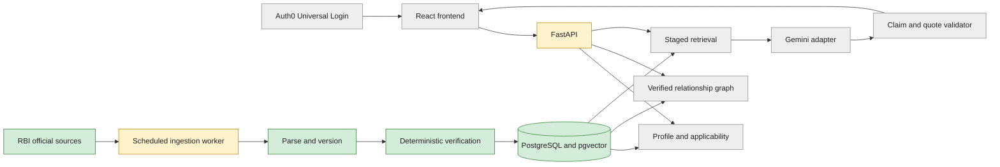
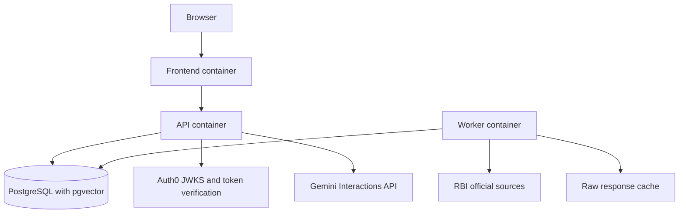
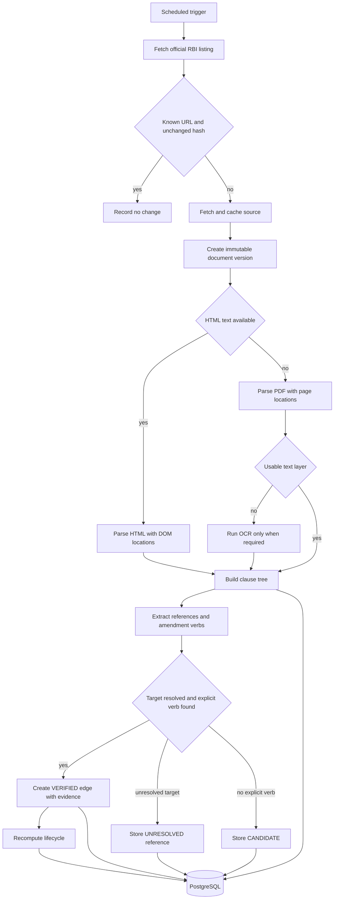
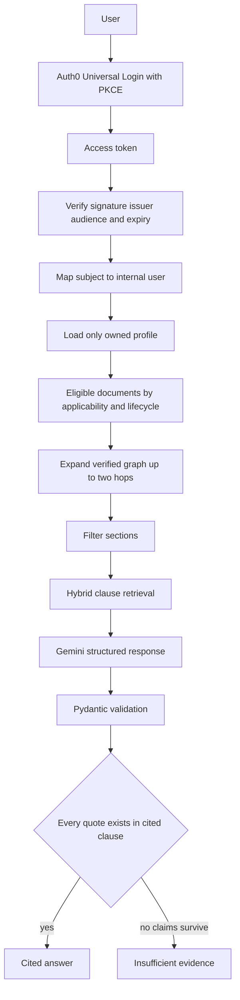
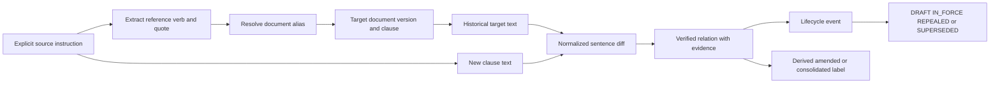
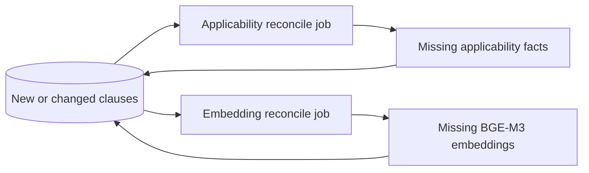

# flow.md — Current Architecture and Build Status

Living document. It shows what is designed and what has actually been built. Update it at the end of every phase and whenever the architecture changes.

**Last updated:** 2026-11-01 · **Current phase:** Phase 1 in progress; ingestion core accepted, scheduled discovery pending

Status legend: `Planned` means designed only · `In progress` means implementation has started · `Done` means the acceptance check passed · `Changed` means the implementation differs from the plan and has a decision entry

---

## 1. Overall architecture with build status

The gold ingestion, immutable versioning, parsing and database path are implemented. Authentication, relevance, retrieval, Gemini and the product frontend remain planned.

## 2. Component status

| Component | Phase | Status | Notes or acceptance |
|-----------|-------|--------|---------------------|
| Docker Compose foundation | 0 | In progress | Database and API validated; frontend not created yet |
| Auth0 authentication contract | 0 | Planned | Issuer, audience, JWKS and PKCE configuration documented |
| Gold corpus and labelled pairs | 0 | In progress | Six official URLs and hashes locked; labelled pairs pending |
| Scheduler and source discovery | 1 | Planned | Idempotent polling and recorded ingest runs |
| Immutable document versioning | 1 | Done | Normalized hashes; immediate six-source rerun created zero versions |
| HTML and PDF clause parsing | 1 | Done | All configured gold clauses found; HTML live and PDF unit tests pass |
| Document and clause read API | 1 | Done | Health, document list and latest clause-tree endpoints smoke-tested |
| Reference extraction | 2 | Planned | Identifier and amendment patterns tested |
| Relationship resolution and verification | 2 | Planned | RBI/2025-26/44 AMENDS paragraph 8.1 with verified evidence |
| Lifecycle engine | 3 | Planned | State and derived historical labels tested |
| Applicability engine and ontology | 3 | Planned | Exclusion and subsumption tests pass |
| Embedding reconciliation | 4 | Planned | BGE-M3 vectors stored separately from clauses |
| Staged retrieval | 4 | Planned | Eligible documents, graph, section and clause stages enforced |
| Gemini adapter | 4 | Planned | Stateless structured output and local Pydantic validation |
| Claim and quote validation | 4 | Planned | Unsupported or fabricated claims are rejected |
| Authenticated profile isolation | 5 | Planned | Cross-user access attempts are rejected |
| Frontend and Relationship Explorer | 5 | Planned | Evidence panel and old-versus-new diff work |
| Evaluation and demo | 6 | Planned | `EVAL.md` reports real counts and failures |

## 3. Docker Compose runtime

Auth0 and Gemini are external managed services. Gemini uses `GEMINI_API_KEY`, `GEMINI_EXTRACT_MODEL=gemini-3.8-flash`, and `GEMINI_ANSWER_MODEL=gemini-3.8-flash`. Secrets and tenant values come from environment variables. PostgreSQL is not exposed directly to the browser.

## 4. Ingestion and versioning flow

PDF evidence stores a page; HTML evidence stores a DOM locator. Both store normalized offsets, source URL, quote, extractor and extractor version.

## 5. Authenticated user request flow

The browser never supplies the effective user ID. Gemini receives only retrieved corpus clauses, uses `store=false`, and has no Search grounding or URL Context.

## 6. Relationship proof and lifecycle flow

Amendment and consolidation remain relationships. They are not stored as mutually exclusive lifecycle states.

## 7. Pull-based reconciliation

Reconciliation jobs find missing outputs and are safe to rerun. Ingestion does not call applicability, embedding or retrieval modules directly.

## 8. Change log

| Date | Change | Related decision |
|------|--------|------------------|
| 2026-11-01 | Initial architecture designed; no code written | D-001 to D-018 |
| 2026-11-01 | Separate embeddings and pull-based reconciliation introduced | D-019 to D-021 |
| 2026-11-01 | Evidence-first authenticated MVP, Auth0 and Docker Compose selected | D-022 to D-024 |
| 2026-11-01 | Gold-first scheduled polling and Gemini structured-output adapter selected | D-025 to D-028 |
| 2026-11-01 | Authenticated ownership, immutable versions and source-specific evidence locations added | D-029 to D-031 |
| 2026-11-01 | Lifecycle representation, embedding storage and single-workstream flow corrected | D-032 to D-034 |
| 2026-11-01 | Official RBI sources made mandatory for stored evidence | D-035 |
| 2026-11-01 | Phase 1 ingestion core implemented with normalized hashing and source ordinals | D-036, D-037 |
| 2026-11-01 | Non-conflicting database port and mandatory source identity validation added | D-038, D-039 |
