# RAAY — Evidence-First MVP Build Plan (Regulatory Relationship Engine)

> Goal: prove, with source-text evidence, (A) which RBI documents relate to which, (B) whether a document applies to a stakeholder, (C) which clauses matter. LLMs may *propose*; deterministic code *verifies*.

**Current status:** Phase 4 in progress. Ingestion, versioning, relationship persistence, applicability matching, evidence-backed repeal lifecycle, scoped lexical retrieval, and Gemini structured-answer path are implemented. Live citation acceptance, Phase 0 labelled pairs, and the deferred Phase 2 historical diff remain pending.

## Product flow: problem and user journey

> **Reference section.** This is the product flow the build must serve. The "what the user can do" list already exists in §1A, so it is not repeated here; this section only adds the problem statement and the end-to-end journey. If equivalent content already exists elsewhere in this file, do not duplicate it.

**Problem.** RBI issues a large volume of circulars, directions, amendments and drafts, and keeps rewriting them. A compliance officer at a small NBFC or microfinance company cannot easily tell (1) which documents apply to their business, (2) what changed and whether the old rule is still in force, and (3) which drafts are open for comment now. Generic chatbots do not solve this: they can sound confident while citing a repealed rule or a document that does not apply.

**Problem statement.** *Regulated entities cannot easily tell which RBI documents apply to them, how those documents connect to existing rules, and what has actually changed, and no current tool proves its answers from the official text.*

**RAAY's answer.** Collect RBI documents, compute how they relate, show each user only what applies, and attach the official sentence as proof. If something cannot be proven, say "not established".

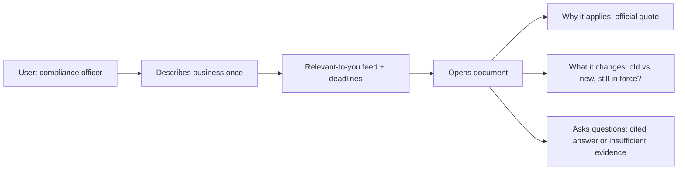

Example: Priya runs a microfinance NBFC. She enters NBFC-MFI, non-deposit-taking, microfinance lending. RAAY shows RBI/2025-26/44 as a direct match, quoting the addressee line, shows that it amends paragraph 8.1 of the 2022 Microfinance Directions with old and new text, and marks whether that rule has since been consolidated.

## 0. Decisions that differ from the original blueprint

| # | Change | Why |
|---|--------|-----|
| 1 | Add a **lifecycle / supersession** layer (`DRAFT`, `IN_FORCE`, `REPEALED`, `SUPERSEDED`) separate from relationship types | On 28 Nov 2025 RBI consolidated into 244 Master Directions and withdrew ~9,445 circulars. The 2022 Microfinance MD and RBI/2025-26/44 are now historical. "AMENDS" alone is not enough. |
| 2 | Prefer **RBI HTML pages** over PDFs; PDF is fallback | Cleaner text, fewer OCR errors, and stable DOM evidence locations |
| 3 | Drop numeric relevance score; use a **rule lattice** (`DIRECT / POTENTIAL / NOT_ESTABLISHED`) | Score invites false precision and can override exclusions |
| 4 | **Entity ontology with subsumption** (NBFC ⊃ NBFC-MFI, layers) | "All NBFCs" must match an MFI; "NBFC-MFI" must not match a plain NBFC-ICC |
| 5 | **Quote-span validator**: every LLM-proposed evidence must exist verbatim (normalised) in source | Kills hallucinated evidence |
| 6 | **Hierarchical (staircase) retrieval** instead of flat top-k RAG | See §6 |
| 7 | Free ground truth from RBI's withdrawn-circulars annex + repeal clauses | Cheap gold labels for REPEALS edges |
| 8 | Two ID schemes handled via `document_aliases` (`RBI/2025-26/44` and `DoR.FIN.REC.25/03.10.038/2025-26`) | Reference resolution fails otherwise |

## 1. System architecture

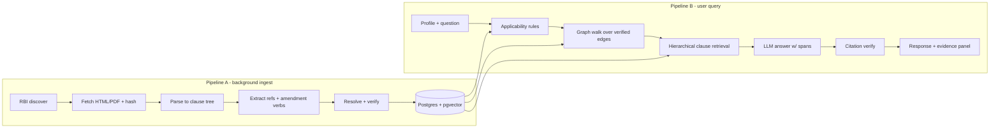

Stack: Python 3.12, FastAPI, Postgres 16 + pgvector + FTS, httpx, selectolax, PyMuPDF (fallback), rapidfuzz, pydantic; React (Vite) frontend. Auth0 provides Universal Login through Authorization Code with PKCE. Docker Compose runs the frontend, API, scheduled worker and database. No Neo4j: recursive CTEs cover the graph.

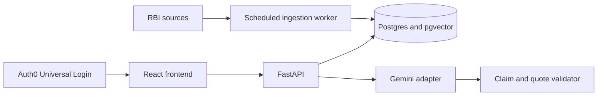

## 1A. Global knowledge base vs per-user data

**One shared (global) knowledge base. Users only add a small profile.** Nothing is scraped or parsed per user.

| Layer | Scope | Contents | Updated by |
|-------|-------|----------|-----------|
| Global KB | Shared by all users | documents, clauses, relations, lifecycle, `applicability_facts`, embeddings | Scheduled ingest (§1C) |
| User data | Per user | internal user record, `stakeholder_profiles`, cached analysis results | Authenticated user |

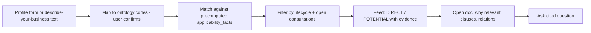

**How a user's documents are found** (heavy work precomputed, cheap join at query time):
1. *Ingest time, once per document:* extract addressee/applicability text into `applicability_facts(entity_code, polarity, conditions, quote)`. RBI's "Draft Directions (RE-wise)" listing gives a free coarse entity tag: use it as a hint, never as proof.
2. *Profile time:* short form (entity type, NBFC category/layer, activities, deposit-taking, size). Optional free text is mapped to ontology codes by the LLM, then **confirmed by the user**. Never infer silently.
3. *Query time:* ontology-aware SQL join (profile codes under applicable codes via subsumption, minus exclusions), then rule checks on conditions, giving DIRECT / POTENTIAL / NOT_ESTABLISHED. Cached in `analysis_results`; invalidated when the profile changes or a new document lands.
4. *Clause level:* only for documents that passed step 3. Rank clauses with a matching `applicability_facts.clause_id` first, then retrieval.

**What the user can do:**
1. Sign in through Auth0 and create or edit a profile. 2. See a "Relevant to you" feed (open consultations with deadlines, recent circulars, lifecycle chips). 3. Open a document: why it applies (quote), which clauses, what it amends or is amended by, old vs new text. 4. Ask questions scoped to chosen documents: cited answer or "insufficient evidence". Comment drafting and alerts are deferred beyond the MVP.

## 1B. Models (free-first)

| Role | Default | Alternatives | Notes |
|------|---------|--------------|-------|
| Embeddings | **BGE-M3** (MIT, 1024-d, 8k context, dense + sparse in one model), run locally | Qwen3-Embedding-0.6B (Apache 2.0, 1024-d); nomic-embed-text-v2-moe (Apache 2.0, 768-d, CPU-friendly); EmbeddingGemma-300m (Gemma terms) | Use `sentence-transformers`. Schema uses `VECTOR(1024)`. Published multilingual benchmarks favour Qwen3-0.6B, but pick with a 30-min test: 20 queries on gold clauses, compare recall@5. Store `embedding_model` per row. |
| Keyword search | Postgres FTS (`tsvector`) | none | no model, first-class signal for clause numbers and defined terms |
| Reranker | skip in MVP | bge-reranker-v2-m3 on top-20 | add only if recall@5 is poor |
| Extraction / classification LLM | **Gemini 3.8 Flash** via Gemini Interactions API | another provider through the internal interface | structured JSON output; every proposed span passes the validator |
| Answer LLM | **Gemini 3.8 Flash** via Gemini Interactions API | another provider through the internal interface | returns `claims[{text, clause_id, quote}]` and cannot retrieve external facts |
| OCR | Tesseract, only if no text layer | none | lazy; most RBI pages have HTML |
| Rules | regex, rapidfuzz, ontology SQL | none | most of the pipeline is deterministic |

Gemini integration uses `google-genai` behind `llm.complete(input, schema)`. Configure `GEMINI_API_KEY`, `GEMINI_EXTRACT_MODEL=gemini-3.8-flash`, and `GEMINI_ANSWER_MODEL=gemini-3.8-flash`. Calls use the Interactions API with `store=false`, small Pydantic-generated JSON Schemas, and local `model_validate_json()` validation. Handle invalid output, refusal, timeout, quota and provider failures explicitly. Do not enable Google Search grounding or URL Context: regulatory facts may come only from the ingested RBI corpus. See the official [model list](https://ai.google.dev/gemini-api/docs/models), [Interactions API guide](https://ai.google.dev/gemini-api/docs/interactions-overview), and [structured output guide](https://ai.google.dev/gemini-api/docs/structured-output).

Embeddings remain local. Hosted Gemini calls run only on candidate spans and grounded answers, never on an unrestricted web search or the full RBI site.

## 1C. Scheduled ingestion (yes, a cron job)

| Source (RBI) | Cadence | Purpose |
|--------------|---------|---------|
| Draft Notifications/Guidelines (+ "Draft Directions (RE-wise)") | every 3 h, weekdays | open consultations, comment deadlines |
| Notifications / Amendment Directions | every 3 h, weekdays | new circulars and amendments |
| Master Directions index | daily | new or replaced Directions |
| Circulars Withdrawn | daily | REPEALS edges, lifecycle |
| Open consultations re-check | daily | deadline extensions, final issuance |

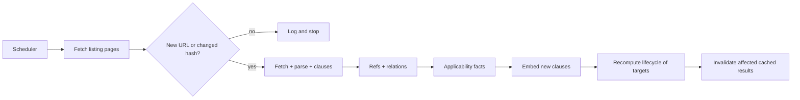

Implementation: `python -m app.ingest.run --source gold|drafts|notifications|masterdirs|withdrawn`, triggered by APScheduler in the Docker Compose worker. It is idempotent, records one row per run in `ingest_runs`, and loads the gold corpus before live polling. Listing-page polling is the primary path; use RSS only after Phase 0 verifies an official working feed.

## 2. Data model (delta over the original six tables)

```sql
documents(id, rbi_ref, dept_ref, title, doc_type, published_at, effective_at,
          lifecycle_state, valid_from, valid_to, source_url)
document_versions(id, document_id, version_no, retrieved_at, content_hash,
          raw_cache_path, source_format)
document_aliases(document_id, alias, alias_kind)          -- rbi_ref, dept_ref, short title
clauses(id, document_version_id, parent_id, path, clause_no,
        page NULL, dom_locator NULL, char_start, char_end, text, tsv)
clause_embeddings(clause_id, model, embedding VECTOR(1024))
clause_versions(clause_id, source_document_id, old_text, new_text, diff_json)
document_relations(id, source_id, target_id, target_ref_raw, target_clause,
        relation_type,        -- AMENDS REPLACES REPEALS CONSOLIDATED_INTO IMPLEMENTS RELATED_TO
        evidence_text, evidence_page NULL, evidence_dom_locator NULL, char_start, char_end,
        evidence_type,        -- EXPLICIT_REF | AMEND_INSTRUCTION | REPEAL_LIST | SEMANTIC
        verification_status,  -- VERIFIED | UNRESOLVED | CANDIDATE
        extractor, extractor_version)
entity_ontology(code, parent_code, label)
applicability_facts(document_id, clause_id NULL, entity_code, polarity, -- INCLUDES|EXCLUDES
        condition_json, evidence_text, char_start, char_end)
users(id, auth0_sub UNIQUE, created_at)
stakeholder_profiles(id, user_id, version, ...)
analysis_results(id, user_id, profile_version, kb_revision, ...)
```

Effective lifecycle states are `DRAFT`, `IN_FORCE`, `REPEALED`, and `SUPERSEDED`. Amendment and consolidation are relationships, not mutually exclusive states. UI labels such as "Amended" and "Historical — consolidated" are derived from lifecycle events and verified edges.

Invariants (enforced by constraints/tests): `VERIFIED` ⇒ non-empty `evidence_text`, source URL, normalized offsets, and either a PDF page or HTML DOM locator; `AMENDS/REPLACES/REPEALS/CONSOLIDATED_INTO` ⇒ `evidence_type != SEMANTIC`; document versions are immutable; user-owned rows are queried only through the authenticated user's internal ID.

## 2A. Authentication and API contracts

Auth0 Universal Login uses Authorization Code with PKCE. FastAPI validates token signature through JWKS plus issuer, audience and expiry, then maps the `sub` claim to `users.auth0_sub`. The browser never supplies the effective user ID. Ingestion and reconciliation remain worker/CLI operations and are not exposed to ordinary users.

Authenticated contracts: `GET /me`; profile create/read/update; relevant-document feed; document details, versions, clauses, lifecycle, relations, evidence and diffs; scoped question answering. Every profile, cache and question query is filtered by the internal user ID derived from the verified token.

---

## Phase 0 — Foundation, source lock and gold corpus

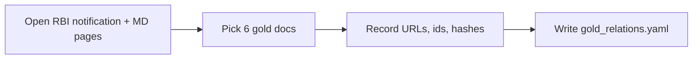

Gold corpus (verify every ref against RBI before trusting it):
- MD Microfinance Loans Directions 2022 (14 Mar 2022)
- RBI/2025-26/44, 6 Jun 2025, para 8.1 (addressed to all NBFC-MFIs)
- RBI/2025-26/100, 28 Nov 2025, withdrawal of circulars + annex
- RBI (NBFC – Microfinance Institution) Directions 2025 (RBI/DOR/2025-26/371)
- KYC MD 2016 + Nov 2024 amendment (`RBI/2024-2025/87`, `DOR.AML.REC.49/14.01.001/2024-25`)
- 1 unrelated NBFC document (negative control)
- Check whether RBI exposes usable RSS feeds; else plan listing-page polling (§1C)

**Deliverables:** `data/gold/corpus.yaml`, `data/gold/gold_relations.yaml` (≥10 labelled pairs), repo skeleton, Docker Compose services, Auth0 configuration contract, DB up.
**Output:** a table of doc → URL → ref → date → expected relations.

## Phase 1 — Ingest, version and parse

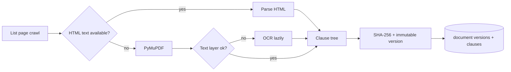

Steps: throttled fetch (cache raw bytes, respect robots), regex IDs, create a new immutable version only when the hash changes, build clause tree (`8.1`, `(a)`, `(i)`, annex), keep PDF page or HTML DOM locator plus normalized offsets, FTS index.
**Deliverables:** `ingest/` module + scheduler entry point (§1C), idempotent re-run (no duplicate rows or versions), parser tests on 6 gold docs, 100% of gold clause numbers found.
**Output:** `GET /documents` and `GET /documents/{id}/clauses` return the tree with offsets.

## Phase 2 — References and relationship engine

**Current status:** Partially accepted. Verified relationship persistence and evidence API work. The specific historical 75 percent text is unavailable from a reproducible official artifact, so that old/new acceptance case is deferred. Sentence-diff behavior remains covered by an independent deterministic test case.

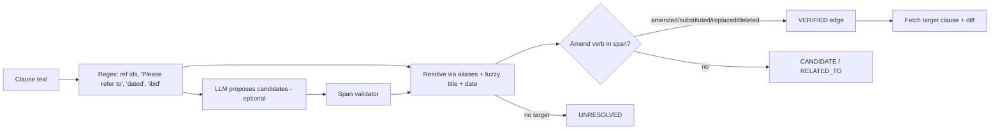

Rules: AMENDS/REPLACES/REPEALS only from explicit instruction text or a repeal list. Semantic similarity can only create `CANDIDATE`, shown as "Potentially related — not officially verified".
**Deliverables:** `refs/extract.py`, `relations/classify.py`, `relations/resolve.py`, `relations/diff.py`, repeal-annex parser, unit tests per verb pattern.
**Output (must match exactly):**
```json
{"source":"RBI/2025-26/44","target":"MD Microfinance Loans 2022","type":"AMENDS",
 "target_clause":"8.1","evidence_type":"EXPLICIT_REF","status":"VERIFIED",
 "evidence_text":"Please refer to paragraph 8.1 of the Master Direction ...",
 "old_text":"...","new_text":"...","diff":[...]}
```

## Phase 3 — Lifecycle and applicability

**Current status:** Complete with an evidence-driven output correction. Ontology subsumption, exclusions, conditions, deterministic addressee extraction, persistence, and lifecycle computation are implemented. The official withdrawn-circular table verifies repeal but names no consolidation target.

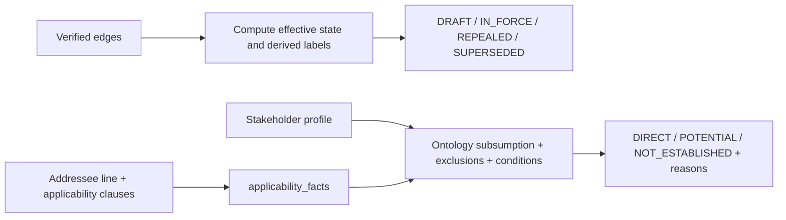

Rules: excluded entity ⇒ never DIRECT; unmet condition (e.g., deposit-taking, layer) ⇒ POTENTIAL at best; date logic marks `proposed / effective / historical / repealed`.
**Deliverables:** `lifecycle/`, `applicability/` with ontology seed (NBFC, NBFC-ICC, NBFC-MFI, layers, banks), table-driven tests (≥15 profile×doc cases).
**Validated output:** for NBFC-MFI profile × RBI/2025-26/44 → `DIRECT`, reason “addressed to all NBFC-MFIs,” status `HISTORICAL — repealed`. For plain NBFC-ICC profile → `NOT_ESTABLISHED`. `HISTORICAL — consolidated` is forbidden until separate official evidence names the consolidation target.

## Phase 4 — Hierarchical retrieval and grounded answers

**Current status:** In progress. Scoped current-version FTS retrieval, verified-edge expansion, Gemini Interactions integration, structured claims, and local quote validation are implemented. A live question returned a claim whose quote matched clause 8.1 and included its official RBI source location. Semantic retrieval and remaining Phase 4 edge cases remain.

```mermaid
flowchart LR
  Q[Question + profile + doc scope] --> S1[Step 1: eligible docs via applicability + lifecycle]
  S1 --> S2[Step 2: expand along verified edges 1-2 hops]
  S2 --> S3[Step 3: section filter by heading FTS]
  S3 --> S4[Step 4: clause hybrid FTS + embedding, RRF]
  S4 --> LLM[Gemini with numbered clauses] --> CV[Citation + quote verify] --> OUT[Answer or 'insufficient evidence']
```

**Deliverables:** `retrieval/` (tree-scoped hybrid search), `answer/` (provider-neutral interface plus Gemini adapter, prompt with clause IDs, structured output with `claims[{text, clause_id, quote}]`), local Pydantic validation, and a verifier rejecting any claim whose quote is not in the cited clause.
**Output:** answer where every sentence links to a clause and its PDF page or HTML DOM location; unsupported questions return "Insufficient evidence in the selected documents".

## Phase 5 — Authentication, UI and Relationship Explorer

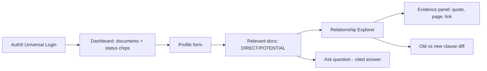

**Deliverables:** Auth0 login/callback/logout flow and 4 screens (Dashboard, Profile, Explorer, Clause/QA). Every badge is clickable to its evidence. Lifecycle banner ("Historical — consolidated into …"). Cross-user profile and cache access is rejected by the API.
**Output:** the "Direct match" card from the blueprint plus lifecycle line and diff view.

## Phase 6 — Evaluation, hardening and demo

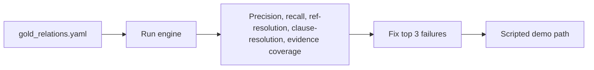

**Deliverables:** `eval/run_eval.py` + `EVAL.md` (metrics table, failures listed honestly), README with run steps, demo script, 3-minute walkthrough.
**Targets:** evidence coverage = 100% on VERIFIED edges; zero SEMANTIC-only AMENDS/REPLACES; reference resolution ≥ 90% on gold set. Do **not** claim general accuracy from ~12–20 pairs.

---

## 3. Demo path (≈3 min)
1. Profile: NBFC-MFI, non-deposit-taking, microfinance lending.
2. Open RBI/2025-26/44 → `DIRECT`, show addressee quote.
3. Explorer: AMENDS → MD 2022 para 8.1, show old/new diff.
4. Lifecycle: show `HISTORICAL — repealed` from verified withdrawal evidence. Show a consolidation target only if separate verified evidence names it.
5. Switch profile to plain NBFC-ICC → `NOT_ESTABLISHED`.
6. Ask an unsupported question → "Insufficient evidence".

## 4. Deferred scope and fallback order
Comment drafting, alerts, broad RBI crawling and cloud deployment are outside the MVP. If delivery must be reduced further: 1. embeddings (FTS-only still works), 2. OCR unless a gold document requires it, 3. diff UI (show raw old/new). Do not cut authentication, evidence validation, immutable versions or lifecycle handling.

## 5. Top risks

| Risk | Mitigation |
|------|-----------|
| Reference text varies ("ibid", short titles) | Alias table + fuzzy title + date, else UNRESOLVED (never guess) |
| Target document not ingested | Seed catalogue from RBI Master Directions index first |
| Amendment applied to a later, consolidated text | Store `version`; diff against the pre-amendment version only |
| RBI site layout/URL changes | Cache raw responses; parse by stable `Id`; selectors in one file |
| Gemini returns schema-valid but unsupported claims | Validate with Pydantic, then require every quote to exist in the cited clause |
| Auth0 subject spoofing or cross-user access | Derive ownership only from a fully verified token and test tenant isolation |
| Delivery overrun in Phases 1–2 | Fixed gold set; don't crawl the whole site |

## 6. Definition of done
- [ ] Gold relations produced by code, not hand-entered
- [ ] Docker Compose starts the database, API, worker and frontend
- [ ] Auth0 login works and cross-user access is rejected
- [ ] Every VERIFIED edge has quote + source-specific locator + normalized offsets + URL
- [ ] HTML evidence has a DOM locator; PDF evidence has a page; both have normalized offsets
- [ ] Source changes create immutable document versions
- [ ] Lifecycle chain shown for the microfinance example
- [ ] Applicability tests pass including exclusion cases
- [ ] Unsupported question refused
- [ ] Gemini calls are stateless, schema-validated and never use external search grounding
- [ ] `EVAL.md` committed with real numbers
- [ ] `decision.md`, `flow.md` and `README.md` updated and consistent with the code (README setup verified from scratch)
