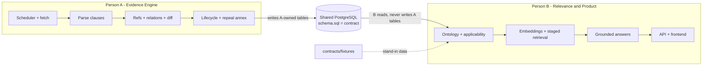

# team.md — Two-Person Work Split

Goal: two people build in parallel with **no coupling**. Work is split at the knowledge-base (KB) boundary, with a short joint "contracts" hour at the start and a joint integration at the end.

## 1. Principles

1. **Split at the KB.** Person A builds what goes *into* the KB (the evidence engine). Person B builds what comes *out* (relevance, retrieval, product).
2. **One-way dependency.** B reads A's tables. A never imports B's code. B never writes to A's tables.
3. **Contract first.** Schema, fixtures and API spec are frozen in Hour 0–1. After that, no cross-talk until the integration points.
4. **Pull, don't call.** No code calls across the boundary. B's jobs find unprocessed rows (missing embeddings, missing applicability facts) and process them, so the scheduler simply runs A's job, then B's job.
5. **Everyone can run alone.** Each person can develop and test against fixtures, with no running copy of the other's work.

## 2. Roles

| | **Person A: Evidence Engine** | **Person B: Relevance and Product** |
|---|---|---|
| Plan phases | 1 (ingest/parse), 2 (refs/relations), lifecycle part of 3, scheduler | applicability part of 3, 4 (retrieval/answers), 5 (UI), API |
| Core question | Can we **prove** how documents relate and whether a rule is in force? | Can we show each user **what applies**, with citations? |
| Hardest risk | Reference resolution, clause parsing | Applicability extraction, citation verification |
| Own eval | `gold_relations.yaml`, relation precision/recall, ref and clause resolution, evidence coverage | `gold_applicability.yaml`, profile × doc matrix, citation accuracy, refusal behaviour |
| Stretch | KYC second pair, bulk REPEALS from withdrawn-circulars annex | Comment drafting with claim verification, alerts |

## 3. Ownership of paths and tables

| Owner | Code paths | Tables written |
|-------|-----------|----------------|
| **A** | `backend/app/{ingest,parse,refs,relations,lifecycle}/`, `data/`, `eval/relations/`, `tests/a_*` | `documents`, `document_aliases`, `clauses`, `clause_versions`, `document_relations`, `ingest_runs` (includes `documents.lifecycle_status`) |
| **B** | `backend/app/{applicability,retrieval,answer,api}/`, `frontend/`, `db/seed_ontology.sql`, `eval/applicability/`, `tests/b_*` | `entity_ontology`, `applicability_facts`, `clause_embeddings`, `stakeholder_profiles`, `analysis_results` |
| **Shared (change by PR + other's approval)** | `db/schema.sql`, `contracts/` (OpenAPI, fixtures, enums), `Makefile`, `.env.example`, `CODEOWNERS` | none directly |

Embeddings live in their own table `clause_embeddings(clause_id, model, embedding)` owned by B, so A's `clauses` table never changes when B switches embedding models (see `decision.md` D-019).

## 4. Contracts (Hour 0–1, done together)

1. `db/schema.sql`: all tables, enums (`relation_type`, `verification_status`, `lifecycle_status`, `polarity`) and the invariants from `plan.md` §2.
2. `contracts/fixtures/`: hand-built JSON for 3 small documents (RBI/2025-26/44, MD Microfinance 2022 para 8.1, MFI Directions 2025 para 12): `documents.json`, `clauses.json`, `relations.json` (A's expected output), `profiles.json`.
3. `contracts/openapi.yaml`: the endpoints B's frontend calls (documents, relations, relevance feed, ask). The frontend uses mock data from it until the real API exists.
4. `Makefile` targets: `load-fixtures`, `load-snapshot`, `export-snapshot`, `test-a`, `test-b`, `reconcile`.
5. `CODEOWNERS` matching the table above; branches `a/*` and `b/*`.

Freeze rule: after Hour 1, any change to a shared file needs a PR approved by the other person and a `decision.md` entry.

## 5. Timeline (parallel)

| Hours | Person A | Person B |
|-------|----------|----------|
| 0–1 | **Joint:** contracts, repo skeleton, gold corpus URLs | **Joint** |
| 1–3 | Fetch + parse to clause tree (HTML first), idempotent ingest | Entity ontology, profile model, applicability matcher with table tests on fixtures |
| 3–5 | Reference extraction, amendment verbs, resolver, diff; RBI/2025-26/44 → MD 2022 para 8.1 VERIFIED | Applicability fact extraction (rules, then LLM with span validator); `gold_applicability.yaml` |
| **5** | **I1:** `make export-snapshot` (first real data) | Switch from fixtures to snapshot |
| 5–7 | Lifecycle, REPEALS from withdrawn annex, scheduler entry point | Embedding mini-benchmark (recall@5), `clause_embeddings`, staged retrieval, reconcile job |
| 7–8.5 | Relation eval (10–12 labelled pairs), fix top failures | Grounded answers + citation verifier, refusal path |
| **8** | **I2:** run scheduler then `make reconcile` on gold corpus; end-to-end test | same |
| 8.5–10 | Stretch (KYC pair), hardening, ingestion/scheduler README sections | API per `openapi.yaml`, 4 UI screens, Relationship Explorer |
| 10–12 | **Joint:** integration fixes, merged `EVAL.md`, demo rehearsal | **Joint** |

Two people compress the sequential 12 hours to roughly 8 to 9 hours of parallel work, which leaves a buffer for integration and stretch goals.

## 6. Integration points

| Point | When | What happens | If it slips |
|-------|------|--------------|-------------|
| I0 | H1 | Contracts frozen and merged | Nothing starts until done |
| I1 | H5 | A delivers first snapshot of real gold data | B continues on fixtures; swap later |
| I2 | H8 | Scheduler + reconcile run end-to-end on gold corpus | Demo from snapshot loaded with `make load-snapshot` |
| I3 | H10 | Joint demo run (path in `plan.md` §3) | Use the cut list in `plan.md` §4 |

## 7. Working rules

- Commit small and often on your own branch; rebase on `main` before opening a PR. Squash-merge.
- A shared-file change needs a PR with the other's approval. Never edit the other's paths.
- Need something from the other person? Write it as a contract change (fixture, schema, or `openapi.yaml`), not a verbal request.
- Ten-minute sync at H3, H5 and H8 only; otherwise asynchronous via PR descriptions.

### Living documents with two people (see `codex.md` §10)
- `decision.md`: A uses IDs `D-A01…`, B uses `D-B01…`. Baseline `D-001` to `D-021` are shared history.
- `flow.md`: each person edits only their own rows in the status table and their own `class` line per status in the diagram (keep separate `class` lines per owner). Shared diagrams change by PR.
- `README.md`: A owns ingestion, scheduler and data setup; B owns API, frontend, models and evaluation sections. Problem, Solution and Architecture are shared and change by PR.
- `EVAL.md` is assembled at I3 from `eval/relations/EVAL_relations.md` (A) and `eval/applicability/EVAL_applicability.md` (B).

## 8. Per-person acceptance checks

| Person | Done when |
|--------|-----------|
| A | Re-running ingest creates 0 duplicates; every gold clause found with page and offsets; RBI/2025-26/44 AMENDS para 8.1 VERIFIED with old/new text; no SEMANTIC-only AMENDS/REPLACES; every VERIFIED edge has quote and offsets |
| B | Table tests pass including an exclusion case and NBFC ⊃ NBFC-MFI; unsupported question refused; every claim has clause id and a verified quote; UI badge opens evidence panel; works fully on fixtures |

## 9. If one person is blocked or unavailable

Either person can run the whole demo from fixtures plus the latest snapshot. If A is late, B demos with the snapshot. If B is late, A demos the Relationship Explorer through plain API JSON. Drop work in the order of the cut list in `plan.md` §4.
